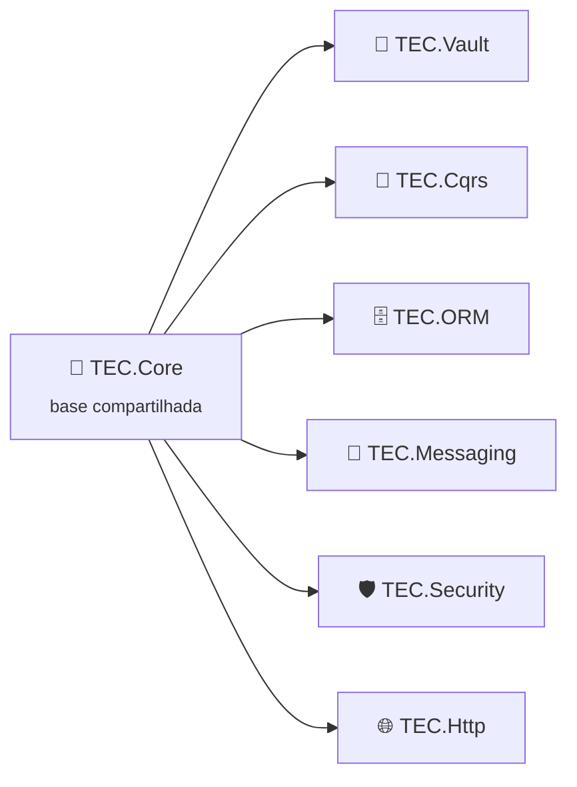

<div align="center">


[🏠 Tudo em Código](https://github.com/tudoemcodigo) › [📦 TEC.Core](https://github.com/tudoemcodigo/lib-tec-core)

# 🧰 TEC.Core

**Primitivas reutilizáveis para aplicações .NET brasileiras:** resultados e erros, respostas de API, documentos, datas e dias úteis, criptografia, CSV e concorrência.

A fundação dos componentes TEC · .NET 10 · Native AOT · sem dependências pesadas

[](https://github.com/tudoemcodigo/lib-tec-core/actions/workflows/ci.yml)
[](https://github.com/tudoemcodigo/lib-tec-core/blob/main/docs/compatibilidade.md)
[](https://github.com/tudoemcodigo/lib-tec-core/blob/main/docs/compatibilidade.md)
[](https://github.com/tudoemcodigo/lib-tec-core/blob/main/CHANGELOG.md)
[](https://github.com/orgs/tudoemcodigo/packages)
[](#%EF%B8%8F-seguran%C3%A7a--testes)
[](https://github.com/tudoemcodigo/lib-tec-core/blob/main/LICENSE)

[📥 Instalação](https://github.com/tudoemcodigo/lib-tec-core/blob/main/docs/instalacao.md) · [🚀 Início rápido](#-início-rápido) · [📚 Documentação](https://github.com/tudoemcodigo/lib-tec-core/blob/main/docs/README.md) · [📝 Changelog](https://github.com/tudoemcodigo/lib-tec-core/blob/main/CHANGELOG.md) · [⚙️ CI/CD](https://github.com/tudoemcodigo/lib-tec-core/blob/main/.github/workflows/README.md)

</div>

## 📑 Sumário

- [✨ Por que usar](#-por-que-usar)
- [📦 Pacote](#-pacote)
- [🧬 Ecossistema TEC](#-ecossistema-tec)
- [📥 Instalação](#-instalação)
- [🚀 Início rápido](#-início-rápido)
- [🧩 Diagrama de arquitetura](#-diagrama-de-arquitetura)
- [📚 Documentação](#-documentação)
- [⚡ Compatibilidade](#-compatibilidade)
- [🛡️ Segurança · 🧪 Testes](#️-segurança--testes)
- [🤝 Contribuição · 🏷️ Versionamento · 📄 Licença](#-contribuição--versionamento--licença)

---

## ✨ Por que usar

| Sem TEC.Core | Com TEC.Core |
|---|---|
| Tratamento de erro diferente em cada serviço | `Result`, `Error` e respostas padronizadas |
| Datas, documentos e formatos brasileiros reimplementados | Cultura pt-BR, CPF/CNPJ, feriados, dias úteis e valores por extenso |
| Criptografia e CSV feitos sob medida em cada aplicação | APIs seguras, versionadas e reutilizáveis com limites definidos |
| Utilitários comuns acoplados à infraestrutura | Primitivas .NET sem dependência de ASP.NET Core, banco ou nuvem |

O pacote usa APIs nativas do .NET sempre que possível e não depende de ASP.NET Core, banco de dados ou provedor de nuvem.

## 📦 Pacote

| Pacote | Para que serve | Quando instalar | Depende de |
|---|---|---|---|
| `TEC.Core` | Abstrações e implementações comuns para os componentes TEC e aplicações .NET | Sempre | `Microsoft.Extensions.DependencyInjection.Abstractions` |

## 🧬 Ecossistema TEC

Os componentes abaixo referenciam o `TEC.Core`:



## 📥 Instalação

O pacote é distribuído no GitHub Packages. Configure o feed conforme [o guia de instalação](https://github.com/tudoemcodigo/lib-tec-core/blob/main/docs/instalacao.md) e autentique o NuGet com uma credencial que tenha leitura dos pacotes da organização.

```bash
dotnet add package TEC.Core --version 0.0.1
```

## 🚀 Início rápido

```csharp
using TEC.Core.Common.Results;

Result<string> result = Result<string>.Success("pronto");
string value = result.Value;
```

Para registrar as implementações suportadas no container de DI:

```csharp
using TEC.Core.DependencyInjection;

services.AddTecCore();
```

Veja exemplos completos e opções em [Common](https://github.com/tudoemcodigo/lib-tec-core/blob/main/docs/common.md), [Injeção de dependência](https://github.com/tudoemcodigo/lib-tec-core/blob/main/docs/injecao-dependencia.md) e nos demais guias.

## 🧩 Diagrama de arquitetura

Componentes e ligações do `TEC.Core`, gerados pelo [GitDiagram](https://gitdiagram.com/tudoemcodigo/lib-tec-core) a partir da `main` em 02/11/2026. O diagrama é gerado por IA a partir de uma amostra do código: use-o como mapa de leitura, não como contrato.

```mermaid
flowchart TD

subgraph group_common["Common contracts"]
  node_results["Results and errors<br/>[Result.cs]"]
  node_guards["Argument guards<br/>[Guard.cs]"]
  node_responses["API responses<br/>[ApiResponse.cs]"]
  node_exceptions["Application exceptions<br/>[AppException.cs]"]
  node_domain["Domain entities<br/>[AggregateRoot.cs]"]
  node_serialization["JSON defaults<br/>[JsonDefaults.cs]"]
end

subgraph group_brazil["Brazilian domain"]
  node_dates["Date formatting<br/>[DateFormatter.cs]"]
  node_holidays["Holiday calendar<br/>[HolidayCalendar.cs]"]
  node_holiday_sources["Holiday sources<br/>[Sources]"]
  node_holiday_model["Holiday model<br/>[Holiday.cs]"]
  node_business_days["Business days"]
  node_timezones["Brazil time zone<br/>[BrazilTimeZone.cs]"]
end

subgraph group_data["Data and documents"]
  node_csv_reader["CSV reader<br/>[CsvReader.cs]"]
  node_csv_parser["CSV parser<br/>[CsvRecordParser.cs]"]
  node_csv_writer["CSV writer<br/>[CsvWriter.cs]"]
  node_documents["Document validation"]
  node_masking["Sensitive data masking"]
  node_text["Text utilities<br/>[Text]"]
end

subgraph group_crypto["Security primitives"]
  node_cryptography["AES-GCM encryption"]
  node_crypto_interfaces["Crypto abstractions"]
  node_crypto_other["Other cryptography<br/>[Cryptography]"]
end

subgraph group_integration["Composition"]
  node_di["Service registration"]
  node_threading["Single-flight concurrency<br/>[SingleFlight.cs]"]
end

node_app(("Application caller"))

node_app -->|"creates result"| node_results
node_app -->|"uses response"| node_responses
node_app -->|"registers services"| node_di
node_responses -->|"maps errors"| node_results
node_responses -->|"maps exceptions"| node_exceptions
node_holidays -->|"filters holidays"| node_holiday_model
node_holidays -->|"uses sources"| node_holiday_sources
node_business_days -->|"queries provider"| node_holidays
node_business_days -->|"uses time zone"| node_timezones
node_csv_reader -->|"parses records"| node_csv_parser
node_cryptography -->|"validates inputs"| node_guards
node_cryptography -->|"implements contract"| node_crypto_interfaces


classDef toneNeutral fill:#f8fafc,stroke:#334155,stroke-width:1.5px,color:#0f172a
classDef toneBlue fill:#dbeafe,stroke:#2563eb,stroke-width:1.5px,color:#172554
classDef toneAmber fill:#fef3c7,stroke:#d97706,stroke-width:1.5px,color:#78350f
classDef toneMint fill:#dcfce7,stroke:#16a34a,stroke-width:1.5px,color:#14532d
classDef toneRose fill:#ffe4e6,stroke:#e11d48,stroke-width:1.5px,color:#881337
classDef toneIndigo fill:#e0e7ff,stroke:#4f46e5,stroke-width:1.5px,color:#312e81
classDef toneTeal fill:#ccfbf1,stroke:#0f766e,stroke-width:1.5px,color:#134e4a
class node_results,node_guards,node_responses,node_exceptions,node_domain,node_serialization toneBlue
class node_dates,node_holidays,node_holiday_sources,node_holiday_model,node_business_days,node_timezones toneAmber
class node_csv_reader,node_csv_parser,node_csv_writer,node_documents,node_masking,node_text toneMint
class node_cryptography,node_crypto_interfaces,node_crypto_other toneRose
class node_di,node_threading,node_app toneIndigo
```



## 📚 Documentação

- [Índice completo](https://github.com/tudoemcodigo/lib-tec-core/blob/main/docs/README.md)
- [Instalação e configuração do feed](https://github.com/tudoemcodigo/lib-tec-core/blob/main/docs/instalacao.md)
- [Compatibilidade, Native AOT e trimming](https://github.com/tudoemcodigo/lib-tec-core/blob/main/docs/compatibilidade.md)
- [Segurança e limites de responsabilidade](https://github.com/tudoemcodigo/lib-tec-core/blob/main/docs/seguranca.md)
- [Testes, carga e benchmarks](https://github.com/tudoemcodigo/lib-tec-core/blob/main/docs/testes.md)
- [Desenvolvimento e publicação](https://github.com/tudoemcodigo/lib-tec-core/blob/main/docs/desenvolvimento.md)
- [Decisões de arquitetura](https://github.com/tudoemcodigo/lib-tec-core/blob/main/docs/adr/README.md)
- [Samples](https://github.com/tudoemcodigo/lib-tec-core/blob/main/samples/README.md)
- [Pipelines e publicação](https://github.com/tudoemcodigo/lib-tec-core/blob/main/.github/workflows/README.md)

## ⚡ Compatibilidade

O pacote mira `net10.0`. Compatibilidade com Native AOT e trimming é documentada e verificada no CI; consulte a [matriz de compatibilidade](https://github.com/tudoemcodigo/lib-tec-core/blob/main/docs/compatibilidade.md) para limites e detalhes por módulo.

## 🛡️ Segurança · 🧪 Testes

O TEC.Core implementa mecanismos reutilizáveis; cada aplicação continua responsável por configuração, autorização, gestão de chaves e tratamento de dados. Consulte [Segurança](https://github.com/tudoemcodigo/lib-tec-core/blob/main/docs/seguranca.md) antes de selecionar algoritmos ou definir armazenamento de segredos.

Para compilar e executar a suíte:

```powershell
dotnet restore TEC.Core.slnx
dotnet build TEC.Core.slnx -c Release
dotnet test --solution TEC.Core.slnx -c Release
```

## 🤝 Contribuição · 🏷️ Versionamento · 📄 Licença

- **Contribuição**: mudanças devem preservar os contratos públicos e incluir testes de comportamento; consulte [Desenvolvimento](https://github.com/tudoemcodigo/lib-tec-core/blob/main/docs/desenvolvimento.md) e [AGENTS.md](https://github.com/tudoemcodigo/lib-tec-core/blob/main/AGENTS.md).
- **Versionamento**: SemVer; a versão inicial deste projeto é `0.0.1`.
- **Licença**: [Apache 2.0](https://github.com/tudoemcodigo/lib-tec-core/blob/main/LICENSE) — consulte [NOTICE](https://github.com/tudoemcodigo/lib-tec-core/blob/main/NOTICE) para informações de atribuição.
